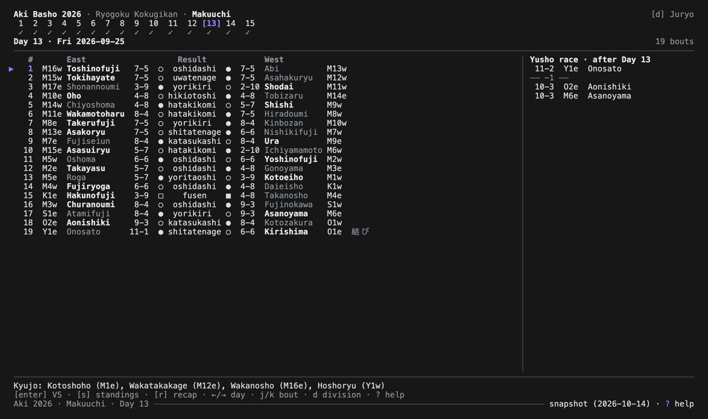

# basho

A terminal app for browsing grand sumo tournaments: day by day, bout by bout,
with a fighting-game-style preview of every bout, standings after any day and
a live mode during tournaments.



**Status:** in development. [`SPEC.md`](SPEC.md) describes what basho does,
how it is built, and the implementation plan.

## Install

Requirements: the Go version in `go.mod`. From a clone:

```sh
make install                 # basho into $(go env GOPATH)/bin
basho                        # the current tournament
basho completion zsh > ~/.oh-my-zsh/custom/completions/_basho   # or any $fpath directory
```

Updates: `git pull && make install`. [`docs/releasing.md`](docs/releasing.md)
has the release steps and [`CHANGELOG.md`](CHANGELOG.md) what changed.

## Development

Requirements: the Go version in `go.mod` and
[golangci-lint](https://golangci-lint.run) v2. `gofumpt` and `govulncheck` run
via `go tool`.

```sh
make help      # all targets
make check     # run before committing
make install   # basho with version info
```

[`docs/charm-v2-notes.md`](docs/charm-v2-notes.md) lists the Charm v2 APIs
basho relies on; v2 differs a lot from v1.

## Data sources

- [sumo-api.com](https://www.sumo-api.com): tournaments, rankings, bouts and
  wrestler data; free and run by a volunteer.
- [osada.us](https://osada.us) ([o-sumo](https://github.com/dai/o-sumo)): live
  results of the current tournament.
- Both derive from the official results of the
  [Japan Sumo Association](https://www.sumo.or.jp).
- Portraits: photos from [Wikimedia Commons](https://commons.wikimedia.org),
  cropped, downscaled and colour-reduced, each under its own licence
  (mostly CC BY-SA). [`data/portraits/CREDITS.md`](data/portraits/CREDITS.md)
  and `basho credits --portraits` credit every photo.

Usage policies and how basho stays polite: SPEC.md §4 and §7.
